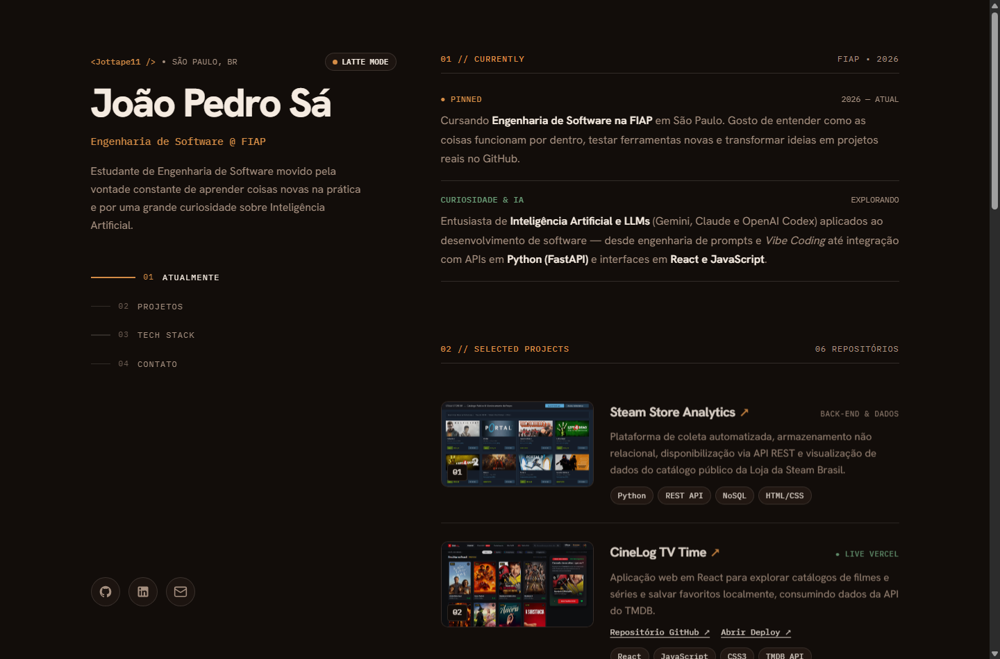

# Portfólio Pessoal — João Pedro Sá (`@Jottape11`)

Landing page de portfólio desenvolvida para o **Checkpoint 6 (Vibecoding)** da disciplina de **Front-End Design** no curso de **Engenharia de Software da FIAP**.



> 📄 **Documentação completa do processo (Referências, IDV, Prompts e Fichas de Correção):** consulte o arquivo [**`documentacao.md`**](documentacao.md).

---

## Sobre o Projeto

O portfólio apresenta minha trajetória acadêmica na FIAP, minhas áreas de estudo em desenvolvimento e Inteligência Artificial e uma curadoria dos **6 principais projetos** do meu GitHub com capturas de tela reais e redirecionamento direto:

1. **Steam Store Analytics** — Coleta automatizada, armazenamento NoSQL, API REST e dashboard de dados da Steam Brasil.
2. **CineLog TV Time** — Catálogo interativo de filmes e séries em React consumindo a API do TMDB ([Deploy na Vercel](https://cinelog-tvtime.vercel.app)).
3. **FastAPI Game Center** — E-commerce full stack de games em Python/FastAPI com arquitetura em camadas e SQLite.
4. **UI Multiverse — VibeCode (Zenit Finance)** — Estudo comparativo de abordagens Front-End (Bootstrap 5, Tailwind CSS e Vibe Coding com GSAP/Lenis).
5. **Projeto Palmeiras** — Landing page temática desenvolvida na disciplina de Front-End Design na FIAP.
6. **Projeto GTA** — Landing page interativa inspirada em Grand Theft Auto V & GTA Online.

---

## Destaques Visuais e Técnicos

- **Layout Vertical Split-Screen:** Coluna esquerda fixa (*sticky*) com navegação dinâmica por seção (*scrollspy*) e coluna direita rolável em fluxo editorial.
- **Paleta Café Dual (*Espresso Mode* & *Latte Mode*):** Alternância instantânea entre tema escuro (`#120D0A`) e tema claro (`#F3ECE3`) com cores 100% sólidas.
- **Animações com GSAP 3 + ScrollTrigger + Lenis:**
  - Rolagem inercial suave (*smooth scroll*) com Lenis;
  - Efeito *Text Scramble* (decodificação de caracteres) nos cabeçalhos das seções e links do menu;
  - Linhas divisórias (*hairlines*) que se desenham conforme o scroll;
  - Inclinação 3D (*Perspective Tilt*) nas miniaturas dos projetos e ícones sociais com efeito magnético.

---

## Tecnologias Utilizadas

- **HTML5 Semântico**
- **CSS3 Customizado** (Variáveis CSS para temas, Grid & Flexbox)
- **JavaScript (ES6+)**
- **GSAP 3.12 & ScrollTrigger** (via CDN)
- **Lenis Smooth Scroll** (via CDN)
- **Google Fonts:** *Hanken Grotesk* & *IBM Plex Mono*

---

## Estrutura de Arquivos

```text
├── assets/
│   ├── cinelog-preview.png              # Print real do projeto CineLog TV Time
│   ├── fastapi-game-center-preview.png  # Print real do projeto FastAPI Game Center
│   ├── portfolio-preview.png            # Print geral do portfólio para o README
│   └── favicon.svg                      # Favicon autoral na paleta Espresso
├── index.html                           # Estrutura principal da landing page
├── style.css                            # Sistema de cores (Espresso/Latte) e layout
├── script.js                            # Animações GSAP/Lenis, scrollspy e interações
├── documentacao.md                      # Entrega completa do CP6 (Refs, IDV, Prompts e QA)
└── README.md                            # Apresentação geral do repositório
```

---

## Como Executar

Basta abrir o arquivo `index.html` diretamente no navegador ou utilizar a extensão **Live Server** no VS Code.

---

**Autor:** João Pedro Sá — [GitHub (@Jottape11)](https://github.com/Jottape11) • [LinkedIn](https://www.linkedin.com/in/jo%C3%A3o-pedro-s%C3%A1/)
